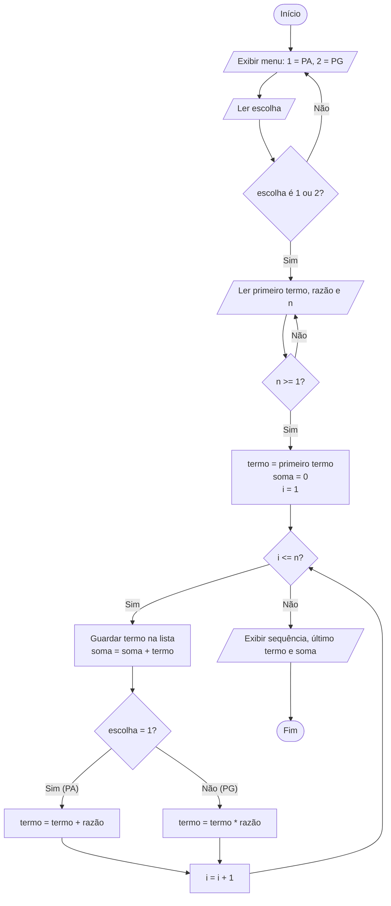
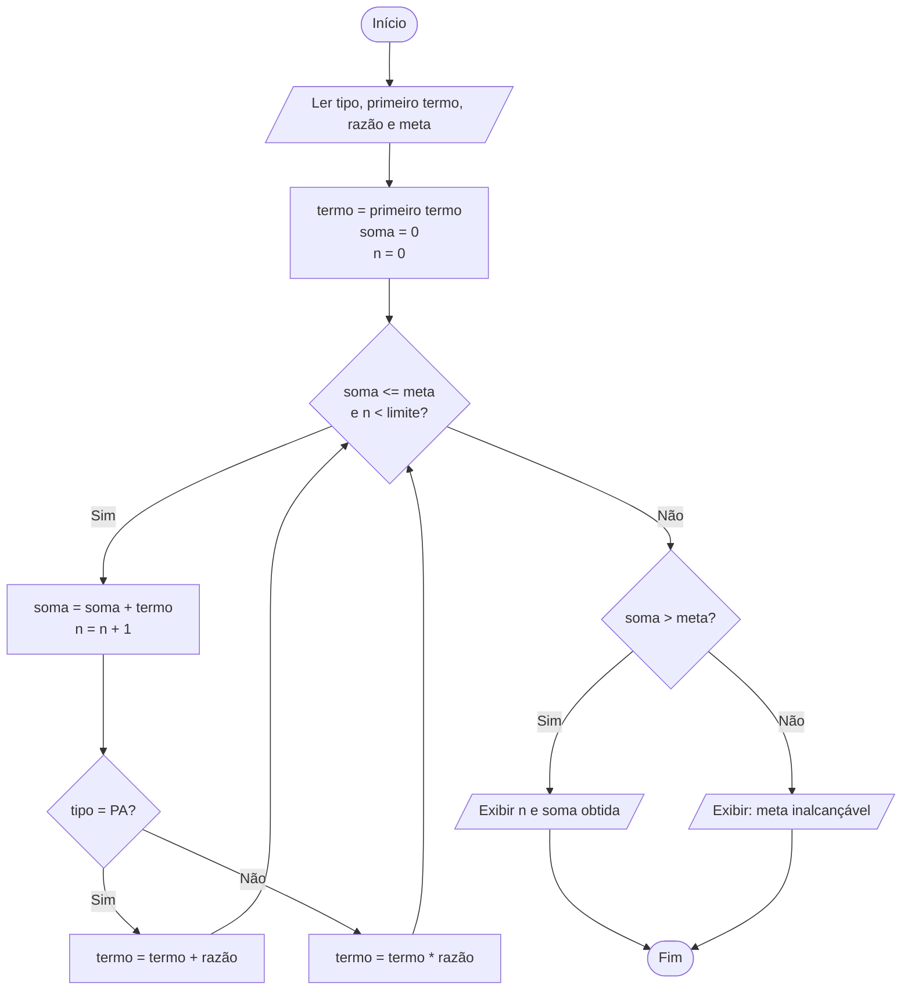

# Etapa 1 — Planejamento: Perguntas, Pseudocódigo e Fluxograma

## 1. Perguntas de planejamento

1. **Informações para construir uma PA:** primeiro termo (`a1`), razão (`r`) e quantidade de termos (`n`).
2. **Informações para construir uma PG:** primeiro termo (`a1`), razão (`q`) e quantidade de termos (`n`).
3. **Próximo termo da PA:** soma-se a razão ao termo atual: `termo = termo + r`.
4. **Próximo termo da PG:** multiplica-se o termo atual pela razão: `termo = termo * q`.
5. **Soma dos termos:** acumulador iniciado em 0; a cada termo gerado, `soma = soma + termo`.

## 2. Pseudocódigo — Etapas 2 e 3 (quantidade de termos informada)

```
INÍCIO
  REPITA
    ESCREVA "PA & PG LAB"
    ESCREVA "1 - Progressão Aritmética"
    ESCREVA "2 - Progressão Geométrica"
    LEIA escolha
  ATÉ escolha = 1 OU escolha = 2

  LEIA primeiro_termo
  LEIA razao
  REPITA
    LEIA n
  ATÉ n >= 1

  termo  <- primeiro_termo
  soma   <- 0
  lista  <- []

  PARA i DE 1 ATÉ n FAÇA
    ADICIONE termo À lista
    soma <- soma + termo
    SE escolha = 1 ENTÃO
      termo <- termo + razao        // PA
    SENÃO
      termo <- termo * razao        // PG
    FIM SE
  FIM PARA

  ESCREVA lista
  ESCREVA "Último termo:", último elemento da lista
  ESCREVA "Soma dos termos:", soma
FIM
```

## 3. Pseudocódigo — Etapa 6 (alcançar a meta; n não é informado)

```
INÍCIO
  LEIA tipo, primeiro_termo, razao, meta
  termo <- primeiro_termo
  soma  <- 0
  n     <- 0

  ENQUANTO soma <= meta E n < LIMITE_SEGURANCA FAÇA
    soma <- soma + termo
    n    <- n + 1
    SE tipo = PA ENTÃO  termo <- termo + razao
    SENÃO               termo <- termo * razao
  FIM ENQUANTO

  SE soma > meta ENTÃO
    ESCREVA "São necessários", n, "termos. Soma obtida:", soma
  SENÃO
    ESCREVA "A meta não é alcançável com esses valores."
  FIM SE
FIM
```

Verificação com o exemplo do enunciado (PG, a1 = 2, q = 2, meta = 1000):
somas parciais 2, 6, 14, 30, 62, 126, 254, 510, **1022** → 9 termos, soma 1022.

## 4. Fluxograma (Etapas 2 e 3)



## 5. Fluxograma (Etapa 6 — Alcançando a meta)


